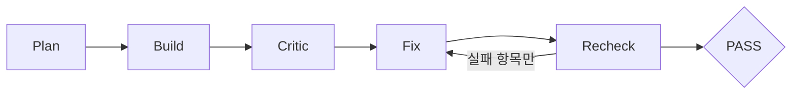
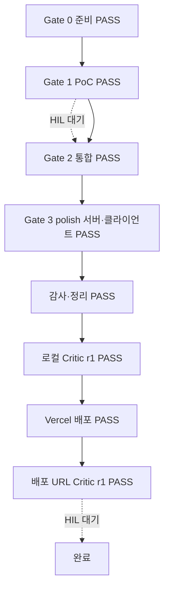
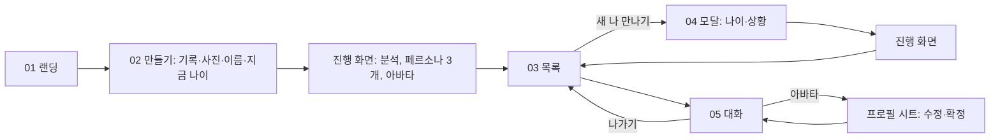

# Mindme 워크플로우 기록

개발이 실제로 어떻게 진행됐는지 정리한 문서다. 근거는 `logs/*`, `evidence/*`, `run.md`.

## 1. 게이트 루프 이력



| 게이트 | 라운드 | 중단·재개 | 판정 |
|---|---|---|---|
| Gate 0 준비 | Critic r1~r4 (수정 r1~r3) | 없음 | PASS. r4 에서 남은 P0 는 report.md 없음 하나였고 저장 후 해소 |
| Gate 1 PoC | 작업별 Critic r1 → r1b (chat 은 P1 수정 후 r1b) | 11/19 네트워크 장애(ENOTFOUND)로 1차 실행 중단, 미커밋 작업을 살려 재개 | 4개 작업 PASS, 통합 회귀 통과, 계약 Critic PASS(P2 4). HIL 은 기다리지 않음 |
| Gate 2 통합 | e2e r1, visual r1→r2, ponytail r1→r2 | 없음 | 3개 Critic 모두 PASS, 열린 P0·P1 없음 |
| Gate 3 배포 | polish(서버·클라이언트) → audit → cleanup → 로컬 Critic r1 → Vercel 배포 → 배포 URL Critic r1 | 없음 | 모두 PASS(1라운드). 열린 P0·P1 없음, P2 는 run.md. 배포 https://mindme-rho.vercel.app |



## 2. 앱 화면 플로우



화면 이동은 상태 하나로 한다. 경로는 `/` 하나다.

## 3. 데이터 흐름

```mermaid
flowchart LR
  subgraph 브라우저
    S[(localStorage: profile·events·personas·photo·chat)]
    UI[MindmeApp + @mindme/ui]
  end
  subgraph apps/web route
    R[analyze · persona · persona/avatar · chat]
  end
  CORE[@mindme/core: schemas·analysis·persona·chat]
  AI[OpenAI: 텍스트 gpt-6-astra, 이미지 gpt-image-2]
  UI <--> S
  UI -- JSON, 스트림 --> R
  R --> CORE --> AI
```

서버는 상태를 갖지 않는다. 키는 서버에서만 읽는다.
